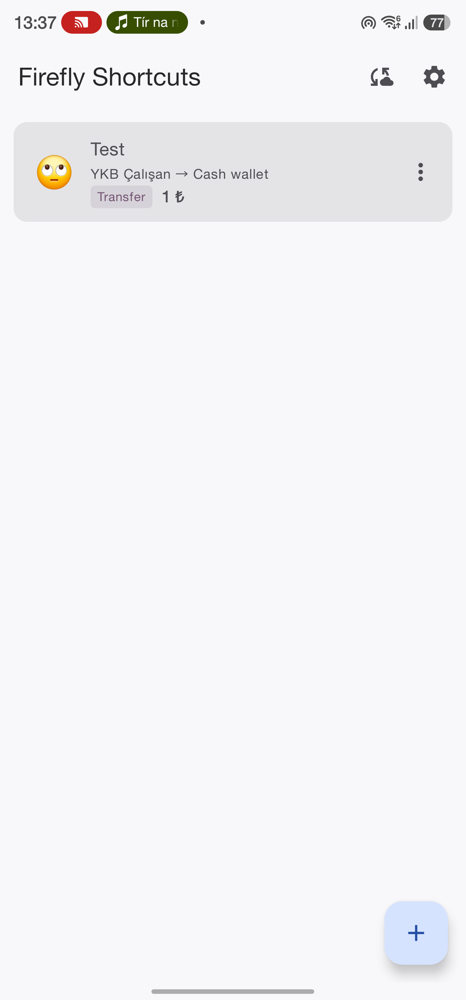
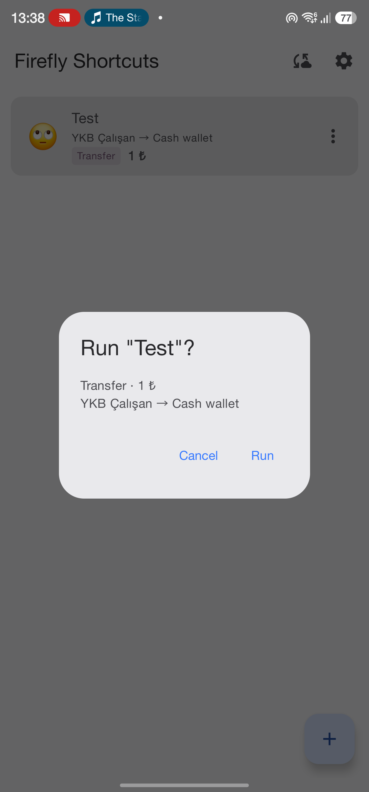
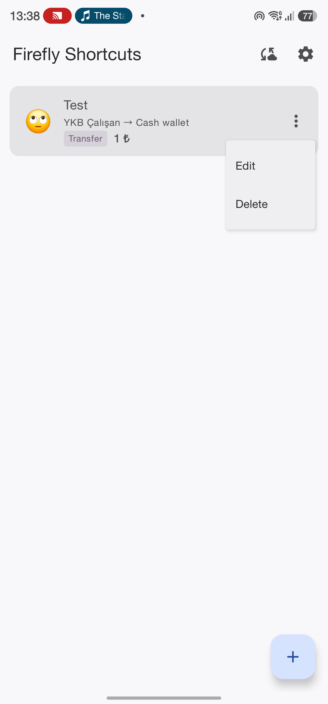
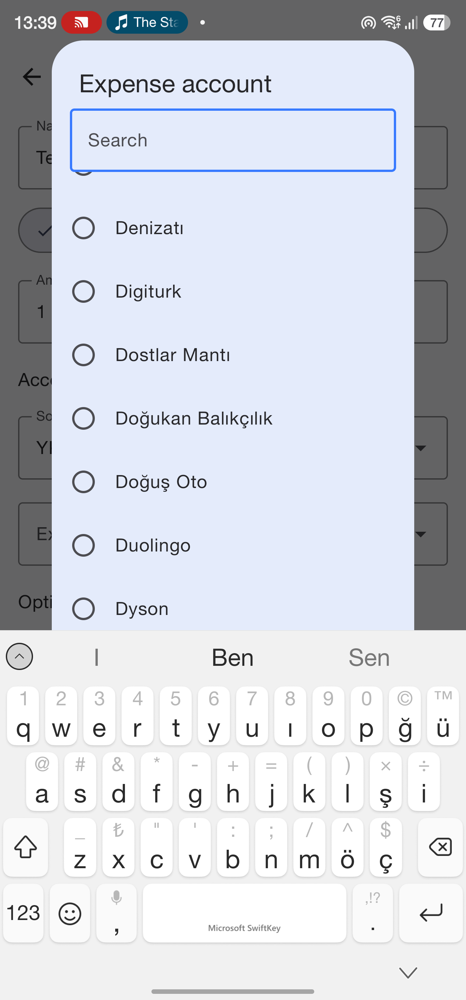
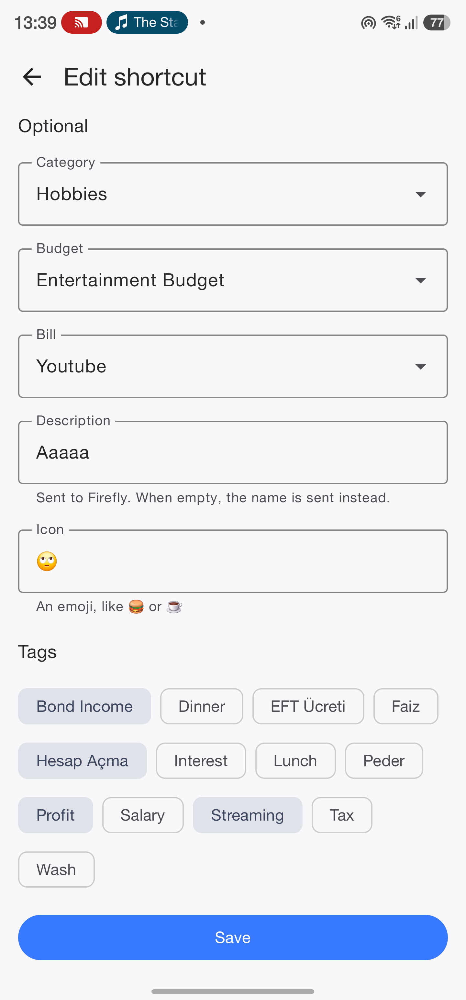
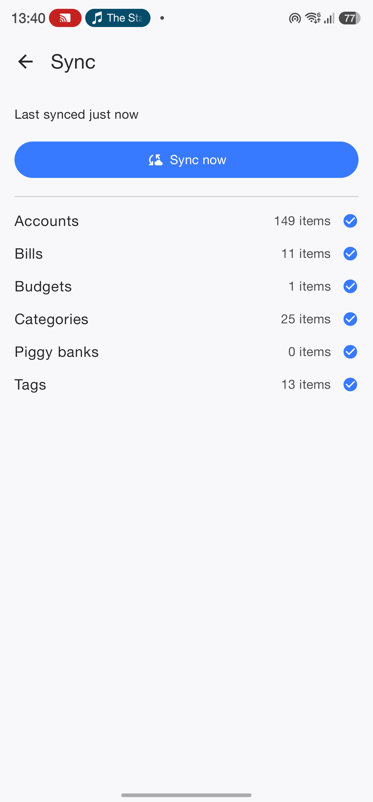
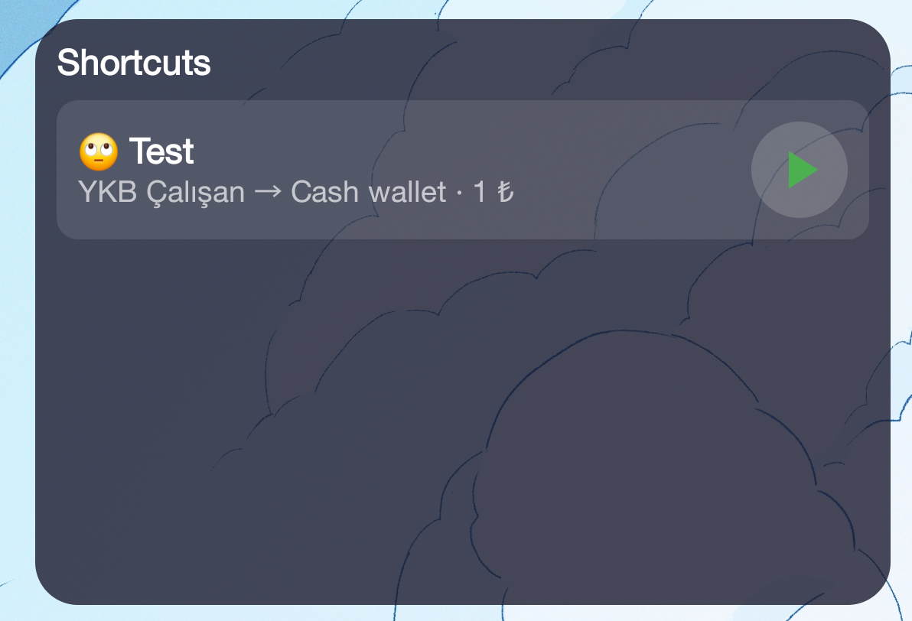
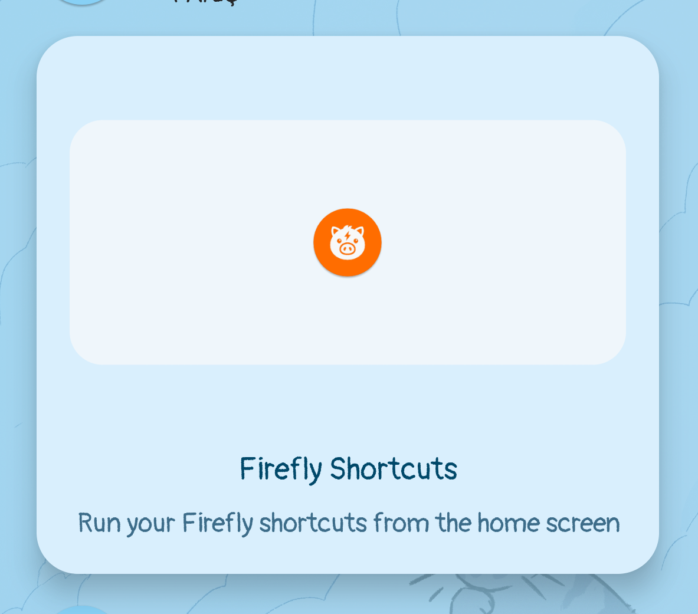

# Firefly Shortcuts

An Android app for running preconfigured [Firefly III](https://firefly-iii.org/) transactions with one tap, from the app or from a home screen widget.

## Background

[Firefly III](https://firefly-iii.org/) is an open-source, self-hosted personal finance manager. It is very good at tracking spending, and it handles accounts in different currencies and transfers between them well.

Adding a routine transaction still means opening a browser or app, going to the transaction form, picking accounts, typing the amount and category, and submitting. For transactions you repeat often but not on a fixed schedule (a daily coffee, a transfer to savings, lunch on work days), that gets tedious.

Firefly Shortcuts lets you set up those transactions once, as *shortcuts*, and run them with a single tap from your home screen. No navigation, no form filling.

## What it does

The app has two parts: the app itself, where you manage shortcuts, and a home screen widget.

In the app you create shortcuts: named, preconfigured transactions. Each one stores everything Firefly III needs: transaction type, amount, source and destination accounts, and optional category, budget, bill, piggy bank, tags and description. You can also give it an emoji icon. The app syncs your accounts and the other lists from your Firefly III server, so you pick them from menus instead of typing them.

The widget lists your shortcuts. Each row has a play button; tap it and the transaction is posted to Firefly III in the background. The button shows what is happening:

- **Play:** ready. Tap to run the shortcut.
- **Hourglass:** the transaction is being sent. Taps are ignored until it finishes.
- **Check:** Firefly III stored the transaction. Back to play after five seconds.
- **X:** the transaction failed. Back to play after five seconds.

You can also run a shortcut from the app's home screen: tap it, check the summary and confirm.

## Screenshots

### The app

  
  
  

Your shortcuts on the home screen. Tapping one shows what it will send and asks before running it. The ⋮ menu edits or deletes it.

### Shortcut editor

  
  
  

Type, amount and accounts, plus optional category, budget, bill, description, icon and tags. Long lists like accounts can be searched.

### Sync

Downloads your accounts and other lists from Firefly III, with a count for each.

### Widget

  
  

The widget on the home screen, and where to find it in the widget list.

## Installation

Download the APK from the [latest release](https://github.com/mcanyucel/firefly-shortcuts/releases/latest). I recommend [Obtainium](https://obtainium.imranr.dev/): add this repository's URL and it installs the app and keeps it updated.

Requirements:

- Android 8.0 (API level 26) or newer.
- A Firefly III server. The app is tested with Firefly III 6.x.

To build the app yourself, see [SETUP.md](SETUP.md).

### Updating from 1.0.x

Version 2.0.0 is a full rewrite: the app used to be built with Flutter and is now a native Kotlin app. It installs over 1.0.x as a normal update, but it doesn't carry over any data. After updating:

1. Open the app and connect to your server again (see below).
2. Sync.
3. Create your shortcuts again.

Widgets already on your home screen keep working; they show a sign-in message until you connect. The old app's data, including its stored tokens, is deleted on the first start.

## First-time setup

### 1. Connect to Firefly III

On first launch, tap the settings icon on the home screen.

- **Server URL:** the address of your Firefly III server, for example `https://firefly.example.com`.
- Then either a **personal access token** or an **OAuth client ID**. See [Authentication](#authentication) for which to use.

Tap **Connect**. The settings screen shows whether you're connected and, for a personal access token, when it expires.

### 2. Sync

Tap the sync icon on the home screen, then **Sync now**. This downloads your accounts, categories, budgets, bills, piggy banks and tags. You need to sync once before you can create shortcuts, and again whenever you add or change any of those in Firefly III.

### 3. Create shortcuts

Tap **+** on the home screen. Required fields:

- **Name:** shown in the app and on the widget.
- **Transaction type:** withdrawal, deposit or transfer.
- **Amount**, like `12.50`.
- **Accounts:** which accounts you can pick depends on the transaction type.

Everything else is optional: category, budget, bill, piggy bank, tags, description and an emoji icon. If the description is empty, the shortcut's name is sent as the description.

To edit or delete a shortcut, use the ⋮ menu on its row. Deleting a shortcut only removes it from your phone; Firefly III isn't affected. If a shortcut uses an account that has since been deactivated or deleted in Firefly III, the app marks it with a warning.

### 4. Add the widget

Long-press an empty area of your home screen, choose **Widgets**, find **Firefly Shortcuts** and drag it onto the home screen. The widget updates by itself when you add, edit or delete shortcuts.

## Widget behavior

- Each tap is sent in the background with Android's WorkManager, so it finishes even if you leave the home screen.
- If the request fails because of the network or a server error, it is tried twice more before the button shows the failure. Every attempt sends the same transaction, and Firefly III rejects it if it already exists, so a retry never creates a second transaction.
- If the button stays on the hourglass for more than five minutes, the next tap starts over.
- If the widget shows **Sign-in needed**, you aren't connected, or your personal access token has expired. Tap the message to open the app.
- Android can delay background work to save battery, especially on phones with aggressive battery savers. If taps often sit on the hourglass, exempt the app from battery optimization in Android's settings.

## Authentication

The app supports two ways to sign in.

### Personal access token (recommended)

Create a token in Firefly III under **Profile → OAuth → Personal access tokens**, name it something like *Firefly Shortcuts*, and paste it into the app. When the token field is filled in, the app uses it instead of OAuth.

The settings screen shows when your token expires and warns you 30 days before. When it runs out, disconnect and enter a new one.

Some Firefly III versions (6.7.9, for example) show the new token as an empty box. To get it anyway, open your browser's developer tools before creating the token, create it, and copy `accessToken` from the response of the request in the Network tab.

### OAuth

1. In Firefly III, go to **Profile → OAuth → Create new client**.
2. Give it a name, set the redirect URL to the one shown in the app's settings (`https://fireflyiiishortcuts.mustafacanyucel.com/oauth2redirect.html` by default), and leave **Confidential** unchecked.
3. Enter the new client's ID in the app and tap **Connect**. Your browser opens so you can sign in to Firefly III.

The app refreshes OAuth tokens by itself, so you don't need to sign in again.

OAuth **doesn't work** if Firefly III signs you in through an authentication proxy such as Authelia (`AUTHENTICATION_GUARD=remote_user_guard`): Firefly III's authorize page fails with a server error. Use a personal access token in that setup.

### Reverse proxies

If your Firefly III server sits behind a reverse proxy with its own login, configure the proxy to let requests to `/api/` through without its login, so they reach Firefly III and are checked by the token alone.

### Switching servers or accounts

Shortcuts belong to the Firefly III server and user they were created for. If you connect to a different server, the app asks first, then deletes the shortcuts and synced data. If you sign in as a different user on the same server, it deletes them as well.

## Backups

Android's backup includes your shortcuts and settings, but not your sign-in: tokens are encrypted with a key that never leaves the phone. After restoring onto a new phone, connect again with the same Firefly III user and your shortcuts are still there.

## Tech stack

- Kotlin and Jetpack Compose (Material 3), with Navigation Compose
- Room (SQLite) for the local database
- OkHttp and kotlinx.serialization for the Firefly III API
- AppAuth for OAuth
- DataStore for settings, and Android Keystore (AES-GCM) for encrypting tokens
- WorkManager to run widget taps in the background
- An `AppWidgetProvider` with `RemoteViews` for the widget, reading the same database as the app

## Notes

- The app only talks to your own Firefly III server. It has no backend, no analytics and no data collection.
- It is Android-only. There are no plans for an iOS version.
- Versions up to 1.0.3 were built with Flutter. That code is archived at [firefly-shortcuts-flutter](https://github.com/mcanyucel/firefly-shortcuts-flutter).

## License

MIT. See [LICENSE.txt](LICENSE.txt).
